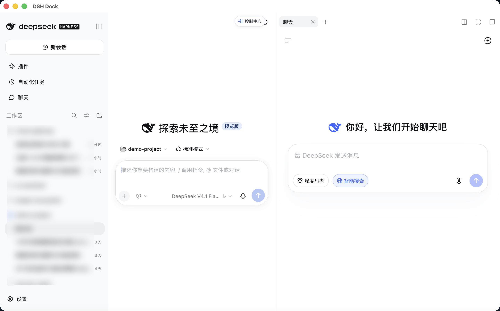
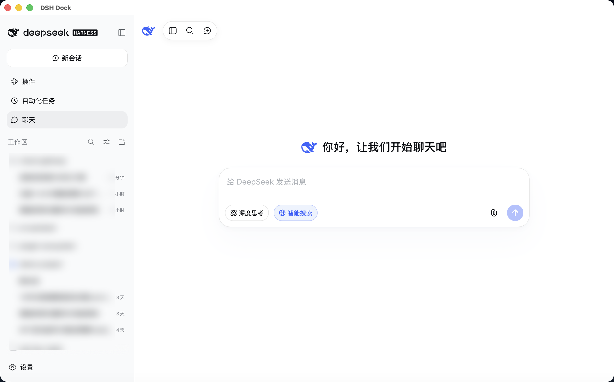
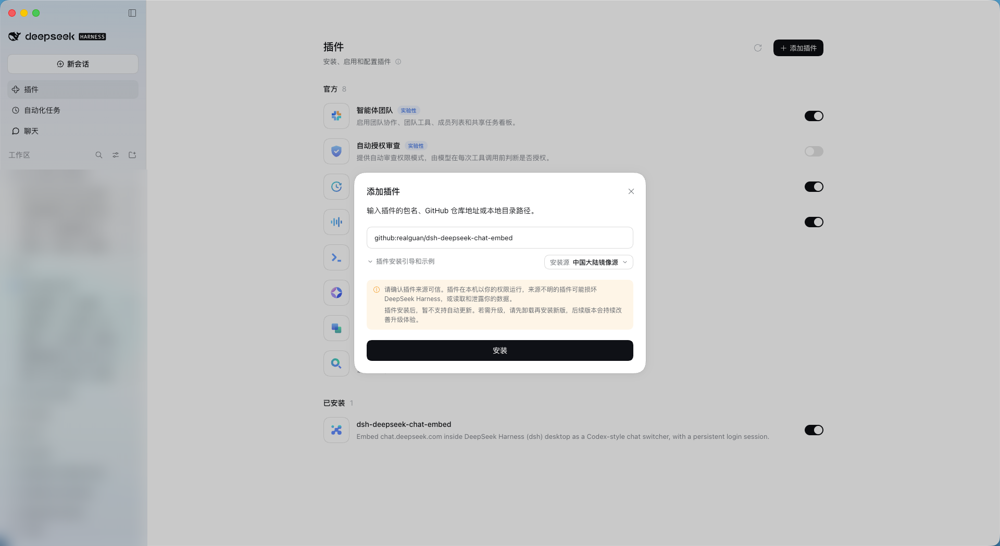

# dsh-deepseek-chat-embed

[](https://opensource.org/licenses/MIT)
[](https://github.com/deepseek-ai)
[-orange.svg)](#-多桌面客户端适配架构desktopguestadapter-策略模式)
[](#-开发与测试自动化门禁)

为 **DeepSeek Harness (DSH)** 打造的专业级跨桌面端 DeepSeek 聊天无缝嵌入插件。在保持 DSH 本地 AI 编程工作流的同时，将官方 `chat.deepseek.com` 深度融合至桌面端，提供沉浸式全屏对话与右侧边栏并排协同两种工作形态。

---

## 📸 运行效果截图

### 1. 右侧栏协同对话模式（边写代码 / 跑终端边即时查阅）
点击顶部导航常驻按钮，在右侧边栏以原生 Tab 并排打开 DeepSeek Chat：


### 2. 中央主面板沉浸式模式（大模型深度规划 / 全屏对话）
点击左侧导航栏的 `💬 聊天` 图标，在中央主工作区沉浸式全屏呈现：


---

## ✨ 核心特性

* 🌓 **双入口架构 (Dual-Entry Design)**：
  * **入口 ①（左侧导航主面板）**：在中央会话区域沉浸式展开 DeepSeek 网页，适合专注向大模型进行长篇咨询或规划；
  * **入口 ②（右上角常驻按钮）**：在右侧栏以原生 Tab 形式呈现，与左侧的代码编辑、文件列表或运行终端并排展示，边写代码边即时查阅。
* 🏛️ **多桌面客户端适配驱动 (DesktopGuestAdapter)**：
  * 采用设计模式中的**策略模式 (Strategy Pattern)**，统一抽象 `DesktopGuestAdapter` 接口；
  * 完美适配 **DSH 官方桌面版 (Electron)** 与 **DSH Dock (Tauri v2)**，上层业务协调器零平台硬编码侵入。
* 🔄 **客页 ↔ 宿主侧栏双向互斥与平滑折叠**：
  * **0ms 即时捕获**：在客页端通过捕获阶段监听展开事件，按下按钮的第一毫秒即向宿主通信，展开客页会话列表与收起 DSH 侧边栏同帧启动；
  * **CSS 同轨线性插值**：采用 DSH 原生缓动变量（`--ds-transition-duration-slow`），完全消除垂直跳动与水平拉扯。
* 🛡️ **非侵入式启发式 DOM 适配**：
  * 对 `chat.deepseek.com` 的 DOM 节点采用结构与语义启发式查找，不写死任何动态生成的混淆类名，抵抗前端站点迭代；
  * 内置针对 WebKit / Chromium 的尺寸抖动防护（Storm Protection），避免终端高频刷屏时触发过载重绘。
* 🔒 **高并发网络隔离保护**：
  * 遥测诊断通道采用显式短连接管理（`Connection: close`）与超时自动熔断（`AbortSignal.timeout`），杜绝 WebKit 6 个 TCP 连接池耗尽导致的页面卡死与终端空白。

---

## 🏛️ 多桌面客户端适配架构（DesktopGuestAdapter 策略模式）

由于 `chat.deepseek.com` 启用了最高等级的同源安全策略 `frame-ancestors 'none'`，普通浏览器 iframe 方案必然被网络层拒绝拦截。插件构建了统一的驱动分发层，针对不同宿主提供最适合的原生解决方案：

```
                           ┌───────────────────────────────┐
                           │         EmbeddedChat          │  (UI 宿主协调器)
                           │   - Overlay DOM 节点与测量    │  · 负责布局互斥与动画
                           │   - 状态广播 / ResizeObserver  │  · 不感知任何底层 IPC
                           └───────────────┬───────────────┘
                                           │
                                  持有统一 Handle 抽象
                                           │
                                           ▼
                           ┌───────────────────────────────┐
                           │      DesktopGuestAdapter      │  (统一策略契约)
                           │  - isAvailable(): bool        │
                           │  - mount(options): Handle     │
                           │  - syncGeometry(rect, frame)  │
                           │  - setVisible(bool)           │
                           └───────────────┬───────────────┘
                                           │
                   ┌───────────────────────┼───────────────────────┐
                   ▼                       ▼                       ▼
       ┌───────────────────────┐ ┌───────────────────┐ ┌───────────────────────┐
       │ ElectronGuestAdapter  │ │ TauriGuestAdapter │ │CustomNativeGuestAdapter│
       │ (DOM <webview>+Lease) │ │(Native Webview IPC)│ │(window.__DSH_CHAT_..)  │
       └───────────────────────┘ └───────────────────┘ └───────────────────────┘
```

### 1. 官方 DSH 桌面版驱动 (`ElectronGuestAdapter`)
* **运行机制**：通过调用主世界注入的 `window.dshDesktop.browser.acquire(WORKSPACE_KEY)` 申请桌面租约；
* **挂载形式**：在 DOM 树中挂载独立的 Chromium `<webview>` 标签；
* **登录态持久化**：使用专有的 `WORKSPACE_KEY` 绑定隔离分区（Partition），登录凭证随工作区持久化保存；
* **几何适配**：DOM 节点随 Overlay CSS 容器自动流动排版，无需外部原生窗口调整。

### 2. DSH Dock 客户端驱动 (`TauriGuestAdapter`)
* **运行机制**：自动检测 `window.__TAURI__` 与 `window.__DSH_PLATFORM__`；
* **原生子视窗 (Native Child Webview)**：将 `chat.deepseek.com` 作为操作系统顶层原生 Webview（WebKit / WebView2）动态挂载到主窗口之上（dsh-dock ADR-0033）；
* **标题栏差值动态补偿**：自动上报 `pageFrame()` 视口尺寸，Rust 宿主计算窗口物理像素与页面 CSS 像素的差值（排除标题栏红绿灯偏移），消除 32px 遮挡；
* **受限安全双向通信通道**：宿主 → 客页走本地校验的 `embed_chat_eval`，客页 → 宿主通过带有校验前缀的通道回传，请求异步串行化配对；
* **优雅降级**：若运行在未提供原生子视窗的旧版 Tauri 环境中，自动平滑降级为「伴侣卡片」引导模式。

### 3. 通用原生多视窗协议 (`CustomNativeGuestAdapter`)
支持任意第三方桌面壳（Wails、Qt、CEF、Flutter 等）通过实现标准接口接入：
```javascript
window.__DSH_CHAT_EMBED__ = {
  open: async ({ url, rect }) => { /* 创建/展示原生子 Webview 并定位 */ },
  hide: () => { /* 隐藏原生子 Webview */ },
  resize: ({ rect }) => { /* 调整原生子 Webview 几何大小 */ },
  close: () => { /* 销毁原生子 Webview */ },
  eval: async (code) => { /* 在子视窗中执行脚本并返回结果 */ }
}
```

---

## 📦 安装与配置

本项目原生支持 **GitHub 仓库一键安装** 与 **本地源码安装**。构建产物 `dist/dsh-deepseek-chat-embed.bundle.js` **随仓库提交**，`package.json` 不含任何安装期构建钩子（`prepare` 已于 v0.1.1 移除）——因此 git 安装不会触发 pnpm 的构建脚本审批，消费者侧零构建、零运行时依赖。

---

### 方式 1：官方桌面客户端图形界面安装（推荐，零命令行）

DSH 官方桌面版内置插件管理器，可直接粘贴 GitHub 仓库地址完成安装：

1. 打开左侧导航的 **设置 → 插件**；
2. 点击页面右上角的 **＋ 添加插件**；
3. 在输入框中填入 GitHub 仓库地址：

   ```
   github:realguan/dsh-deepseek-chat-embed
   ```

4. 按需选择**安装源**（国内网络环境可选「中国大陆镜像源」）；
5. 阅读安全提示后点击 **安装**；
6. 安装完成后**重启客户端**生效。



> ⚠️ **安全提示**：插件在本机以你的权限运行。请仅安装来源可信的插件；来源不明的插件可能损坏 DeepSeek Harness，或读取和泄露你的数据。插件安装后暂不支持自动更新，升级需先卸载再安装新版。

---

### 方式 2：命令行安装（DSH Dock / 自定义 Profile）

```bash
# 安装到当前活动的 Profile
dsh plugin add github:realguan/dsh-deepseek-chat-embed

# 安装到 Web Profile（适用于 DSH Dock 及 Web 端）
dsh plugin --profile web add github:realguan/dsh-deepseek-chat-embed

# 安装到官方桌面版 Desktop Profile（Electron）
dsh plugin --profile desktop add github:realguan/dsh-deepseek-chat-embed
```

若你在自定义的 DSH Profile 目录（如 `~/.dsh/profiles/web/`）下手动管理依赖：

```bash
cd ~/.dsh/profiles/web
pnpm add github:realguan/dsh-deepseek-chat-embed
```

> 通过 `pnpm add` 安装时，需在 `~/.dsh/profiles/web/package.json` 的 `dsh.profile.bundles` 中补充 `"dsh-deepseek-chat-embed"`，重启 DSH 即可使用。

---

### 方式 3：从源码本地安装（开发者）

```bash
# 1. 克隆代码仓库
git clone https://github.com/realguan/dsh-deepseek-chat-embed.git
cd dsh-deepseek-chat-embed

# 2. 编译打包 Client Bundle
npm run build

# 3. 本地链接到目标 Profile
dsh plugin --profile web add link:/path/to/dsh-deepseek-chat-embed
```

---

## 🧭 双入口设计规范与排版逻辑

| 入口编号 | 入口位置 | 触发行为 | 布局特性 |
| :--- | :--- | :--- | :--- |
| **入口 ①** | 左侧导航栏「自动化任务」下方的 `聊天` 图标 | 在**中央主工作区**展示全屏面板 | 自动预留顶部 `--dsh-frame-top-clearance` 避让窗口红绿灯，支持窗口拖拽 |
| **入口 ②** | 会话右上角、原生右侧栏展开按钮旁的图标 | 在**右侧边栏**中打开独立标签页 | 严格作为右边栏的一个 Tab，绝不擅自改变中央列，方便与代码并排对比 |

* **单例生命周期保证**：整个应用生命周期内保持单一 Guest 实例。当在右侧栏打开时，中间列自动归还给会话内容；从左侧导航切换回主面板时，右侧栏标签自动让位，确保登录态与网页状态零重复开销。
* **无干扰退出**：当用户切到其他工作区 Tab（如「文件」或「终端」）时，原生子视窗自动隐藏，绝不遮挡原生内容。

---

## 🧪 开发与测试（自动化门禁）

本项目具备严密的测试驱动体系，代码变更受到 100 项自动化断言约束：

```bash
# 0. 安装开发依赖（仅 jsdom 一项，用于驱动真实 React 的契约测试）
npm install

# 1. 改过 src/client.js 后必须重建 dist —— dist 随仓库提交，消费者侧不再自动构建
npm run build

# 2. 门禁：语法检查 + 校验 dist 与 src 是否同步（不一致会直接失败，防止发出陈旧 bundle）
npm run check

# 3. 运行全量 100 项自动化契约回归测试
npm run test:entries
```

### 自动化验证测试项涵盖（100 / 100 Passed）：
* ✅ **桌面策略模式抽象断言**：`resolveGuestAdapter` 在浏览器环境返回 `undefined`，在 Electron 下正确解析为 `ElectronGuestAdapter`，在 Tauri 下正确解析为 `TauriGuestAdapter`；
* ✅ **几何与显隐代理断言**：`TauriGuestAdapter` 代理 `syncGeometry` 触发 `embed_chat_resize`，代理 `setVisible` 触发 `embed_chat_open` 与 `embed_chat_hide`；
* ✅ **IPC 串行化与安全通道断言**：`embed_chat_eval` 脚本调用保证单一在途，响应通过 Request ID 精确配对，异常捕获与解析行为正确；
* ✅ **双入口与 Slot 注册断言**：`sidebar.panellist`、`main`、`conversation.session.header.utilities`、`shell.overlay`、`sidebar.right.pane.tab` 席位严格符合 DSH 声明规范；
* ✅ **侧栏动画与互斥断言**：即时 `pointerdown` 展开联动、平滑过渡变换以及无害的标记式 DOM 启发式探测；
* ✅ **浮层生命周期断言**（2026-10-14 现场故障）：脱流不变量写在行内（撤掉样式表也仍是 `position: fixed`）、应用期清扫残骸、`destroy()` 释放失败也摘 DOM、宿主离开视口让位、滚动只跟手不空转；
* ✅ **模态弹窗让位断言**（2026-10-15 现场故障）：设置弹窗、通用 Modal 或确认弹窗挂载时，原生子视窗与浮层立即收起让位（`hide`），不遮挡弹窗卡片与全屏遮罩；弹窗卸载后自动无缝恢复展示（`open`）。

### 发布流程（每次发版必须全做）

```bash
npm run build          # 1. 重建 dist —— dist 随仓库提交，消费者侧不会构建
npm run check          # 2. 门禁：语法检查 + dist 与 src 是否同步（不同步直接失败）
npm run test:entries   # 3. 100 项契约回归

# 4. 升版本号（package.json，以及 README 里引用版本/用例数的地方）
git commit -am "chore(release): vX.Y.Z"
git tag -a vX.Y.Z -m "vX.Y.Z"
git push origin main && git push origin vX.Y.Z

# 5. 必须创建 GitHub Release —— 只打 tag 不算发版
gh release create vX.Y.Z --title "vX.Y.Z — <一句话摘要>" --notes-file <发布说明>
```

> **约定：每次推送 tag 都必须同时创建对应的 GitHub Release。** Release 说明按「修复 / 工程 / 安装」三节写，并在正文里给出可直接粘贴的安装规格（`github:realguan/dsh-deepseek-chat-embed#vX.Y.Z`）。

---

## 💡 常见问题与说明 (FAQ)

#### Q: 打开终端时提示 `session "xxx" is already owned by an active write handle` 是为什么？
**A**: 这是 DSH 内核为了防止会话数据（`session.v4.jsonl.zstd`）被并发写入导致文件损坏而设计的**内核单写锁机制 (Single-Writer Lease)**。
当你在同一台电脑上**同时打开了 DSH 官方桌面版与 DSH Dock**，且官方桌面版正在占用该会话时，DSH Dock 会如实收到操作系统的文件锁冲突保护提示。只需在另一个客户端中关闭该会话，或者在当前客户端新建一个会话即可正常使用终端。

#### Q: 为什么在普通的 Web 浏览器（Chrome/Safari）里打不开内嵌？
**A**: 因为 `chat.deepseek.com` 在 HTTP 响应头中配置了 `Content-Security-Policy: frame-ancestors 'none'`，浏览器内核从底层禁止了任何网页通过 `<iframe>` 嵌入该站点。这也是必须使用桌面宿主的原生 Webview 容器（Electron / Tauri）的根本原因。在纯浏览器环境下，插件会自动优雅呈现外部协同引导卡片。

#### Q: 安装时提示 `ERR_PNPM_GIT_DEP_PREPARE_NOT_ALLOWED`（或「需要允许安装脚本」）是什么原因？
**A**: 这是 pnpm 11 的供应链策略：**git 托管的包若要执行构建脚本，必须在该 Profile 的 `pnpm-workspace.yaml` 中按“精确到 tarball（含 commit hash）”的键加入 `allowBuilds` 白名单**。本插件曾声明 `prepare` 构建钩子，因此早期版本会命中这条策略。

* **v0.1.1 及以后**：已移除 `prepare`，客户端直接使用仓库中提交的 `dist/`，安装期不执行任何脚本，不会再出现该提示；
* **v0.1.0 及更早版本**（或其它声明了构建脚本的 git 插件）：把 pnpm 报错里给出的那一行原样加入 `<profile>/pnpm-workspace.yaml` 后重新安装即可：

  ```yaml
  allowBuilds:
    dsh-deepseek-chat-embed@https://codeload.github.com/realguan/dsh-deepseek-chat-embed/tar.gz/<报错信息中的 commit hash>: true
  ```

* 新版桌面客户端在 pnpm 把构建挂起时会给出「**允许这些脚本并重试**」；若客户端只报硬错误、没有该入口，请升级客户端，或按上面的方式手工加白名单。

---

## 🔖 DSH 版本兼容性

插件通过 `peerDependencies` 声明所支持的 DSH 版本范围：

```json
"peerDependencies": {
  "@deepseek-ai/dsh": "0.2.x"
},
"peerDependenciesMeta": {
  "@deepseek-ai/dsh": { "optional": true }
}
```

### 门禁行为（已实测）

| DSH 版本 | 结果 |
| --- | --- |
| `0.2.0-rc.2`、`0.2.1-alpha.2`、`0.2.9` 等 0.2 全系（含预发布版） | ✅ 正常加载 |
| `0.1.x`、`0.3.x`、`1.x` | ⛔ 启动时拒绝加载，并给出明确提示 |

DSH 启动时会校验该声明，版本不匹配时插件不会加载，避免在接口已变更的运行时上静默崩溃。若你确认要在不匹配的版本上强行启用，可按提示授予精确版本豁免：

```bash
dsh plugin --profile web allow-version dsh-deepseek-chat-embed@0.1.0 \
  --dsh-version <你的 dsh 版本> --accept-risk
```

> 豁免仅对**精确的插件版本 + 精确的 DSH 版本**组合生效，且需显式 `--accept-risk` 确认风险；不匹配时 DSH 会在启动日志里直接给出这条可复制的命令。

### 为什么必须加 `peerDependenciesMeta.optional`

这是**必需的一步**，否则会把整个 DSH 运行时拖进 profile：

* 不加 `optional` 时，pnpm 会把该 peer 当作真实依赖从 registry 解析并安装。实测会引入 `@deepseek-ai/dsh-subprocess-local`、`@google/genai`、`koffi`、`node-pty`、`protobufjs` 等整棵依赖树，且锚定**最新稳定版 `0.2.0-rc.2`**，与实际 runtime `0.2.1-alpha.2` 不一致——形成重复模块实例，属于隐患（同类于跨包私有 `Symbol` 不一致导致的作用域失效缺陷）。
* 加 `optional` 后安装保持**零运行时依赖**：实测 GitHub 安装约 100ms 完成，`node_modules` 中仅插件自身；客户端直接使用仓库里已提交的 `dist/`，安装期不执行任何脚本（v0.1.1 起移除 `prepare`，见下方 FAQ）。

### 几个不可用的范围写法（实测）

| 写法 | 结果 |
| --- | --- |
| `^0.2.0` | ❌ `ERR_PNPM_NO_MATCHING_VERSION`：无满足的稳定版，安装直接失败（`0.2.0-rc.2` 按 semver 小于 `0.2.0`，而满足条件的 `0.2.1-alpha.2` 是预发布版，pnpm 默认不选） |
| `workspace:^` | ❌ `ERR_PNPM_SPEC_NOT_SUPPORTED_BY_ANY_RESOLVER`：无法解析 |
| `workspace:*` | ⚠️ 可安装，但恒等于当前 runtime 版本，**不提供任何版本保护** |

> 升级到新的 DSH 大版本后，如需支持，只需修改此处范围并发布新版本即可。

---

## 📄 许可证

[MIT License](LICENSE) © 2026 realguan
